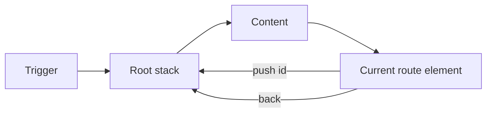

# MobileSheet with a local route stack

React Router does have this: `createMemoryRouter` / `MemoryRouter` keep a history stack off the URL. TanStack Router (what the desktop app uses) has `createMemoryHistory` for the same idea. Neither belongs inside `@nakama/ui`. `MobileSheet` will own a small stack and take a route config shaped like those routers, with an `id` instead of a path.

The reference is the Family drawer in [`.refs/animations.dev_files/63ea8f75acbc3369_jc41.js`](.refs/animations.dev_files/63ea8f75acbc3369_jc41.js) (the “Family’s drawer” card in [`.refs/animations.dev.htm`](.refs/animations.dev.htm)). That demo swaps one view id (`default`, `key`, `phrase`, `remove`) inside a Vaul sheet. The sheet height eases to the next screen, and the screens crossfade with a slight scale. It is not a horizontal iOS push.

## API

Compound parts, same style as [`PreferenceCard`](packages/nakama-ui/src/components/ui/preference-card.tsx). The trigger is a child; the drawer owns open state.

```tsx
<MobileSheet.Root
  routes={[
    { id: 'options', element: <Options /> },
    { id: 'key', element: <PrivateKey /> },
    { id: 'phrase', element: <RecoveryPhrase /> },
  ]}
  initialId="options"
>
  <MobileSheet.Trigger render={<Button />}>Open</MobileSheet.Trigger>
  <MobileSheet.Content title="Options" />
</MobileSheet.Root>
```

Inside a screen, `useMobileSheet()` returns `{ id, depth, canBack, push, replace, back, reset }`. `MobileSheet.Link to="key"` pushes. `MobileSheet.Back` pops one frame. `MobileSheet.Close` dismisses the sheet. An unknown id throws.



Closing resets the stack to `initialId` in `onOpenChangeComplete`, after the sheet has left, so the close animation does not flash the root screen. The wallet copy in the reference stays out of the library; screens are whatever the caller passes.

## Motion

Build the shell on Base UI `Drawer` (portal, focus trap, swipe down), not the styled [`drawer.tsx`](packages/nakama-ui/src/components/ui/drawer.tsx) classes. Those already tween height on a different curve and would fight this animation.

Match the lesson, with semantic colors (`bg-popover`, `bg-black/30`) instead of the demo’s hex palette:

- Floating sheet: inset from the bottom, `max-w-[361px]`, `rounded-[36px]`.
- Height: measure the active screen with a `ResizeObserver`, then `motion` animates that height over `0.27s` with `cubic-bezier(0.25, 1, 0.5, 1)`. First open does not grow from `0`.
- Screens: `AnimatePresence` with `mode="popLayout"` and `initial={false}`. Hidden state is `opacity: 0` and `scale: 0.96`. Ease is `[0.26, 0.08, 0.25, 1]`. Push is `0.27s`, pop is `0.22s`.
- The close button sits outside the crossfade, as in the lesson.
- `useReducedMotion` drops both tweens to duration `0`.

## Settings try-out

Leave a button on the settings page so the sheet can be opened by hand. Add a feature section next to appearance, composed from [`SettingsPage`](apps/nakama-desktop/src/features/settings/components/settings-page.tsx). The route file stays a composition only.

The section is a `PreferenceCard` with one button as `MobileSheet.Trigger`. The sample stack is local to that section, not part of `@nakama/ui`:

- `home` — short copy and a `MobileSheet.Link` that pushes `detail`
- `detail` — taller copy and a `MobileSheet.Back` that pops to `home`

The sheet close control dismisses it. That is enough to see the height tween, the crossfade, push, pop, and close. No wallet copy.

## Files

- Add [`packages/nakama-ui/src/components/ui/mobile-sheet.tsx`](packages/nakama-ui/src/components/ui/mobile-sheet.tsx) and export `MobileSheet`, `useMobileSheet`, and the route type from [`packages/nakama-ui/src/components/index.tsx`](packages/nakama-ui/src/components/index.tsx).
- Add the settings section under `apps/nakama-desktop/src/features/settings/components/` and render it from `SettingsPage`.
- Add a changeset that bumps `@nakama/ui` and `nakama-desktop` (minor).
- Typecheck, then open Settings and exercise the button through open, push, back, and close. The button stays.
